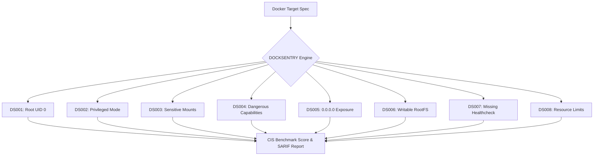

<div align="center">


# DOCKSENTRY
### Open-Source Docker Security Auditing Platform

*Catch insecure container configurations before they become production security breaches.*

[](LICENSE)
[](frontend)
[](frontend)
[](backend)
[](#security-rules)
[](#cicd-integration)

---

</div>

## 🛡️ Overview

**DOCKSENTRY** is an open-source container security auditing platform designed for developers, DevSecOps practitioners, and security engineers. It inspects Dockerfiles, Docker Compose specifications, and live Docker engine environments to identify dangerous misconfigurations, broken isolation boundaries, and privilege escalation vectors.

### Configuration Auditing vs. Vulnerability Scanning
> **Important Distinction:** DOCKSENTRY focuses on **hardening and configuration posture** rather than known package CVEs. Even an image with zero CVEs is vulnerable if configured with `privileged: true`, mounted to `/var/run/docker.sock`, or executing as `root` (UID 0).

---

## 🚀 Key Responsibilities

| Responsibility | What Happens |
| :--- | :--- |
| **Discovery** | Recursively scans workspaces to locate Dockerfiles, Compose specs (`compose.yaml`, `docker-compose.yml`), and queries the local Docker Engine API socket (`/var/run/docker.sock` or Windows named pipe). |
| **Analysis** | Evaluates discovered configurations against **CIS Docker Benchmark v1.6** rules and policy definitions, pinpointing exact code lines and configuration keys. |
| **Reporting** | Visualizes findings with severity categorization, explains attack vectors, provides side-by-side remediation diffs, and exports to **SARIF 2.1.0**, **Markdown**, and **JSON**. |

---

## 🔍 The 8 Core Security Checks



### 1. `DS001` — Container Running as Root (UID 0)
* **Risk:** If an application inside the container is exploited, the attacker inherits root permissions in that container namespace, significantly easing host probing and breakout attempts.
* **Detection:** Inspects whether Dockerfiles declare a non-root `USER` and checks runtime container process UID.
* **Remediation:** Enforce dedicated least-privileged user creation (`useradd -u 10001 appuser`) and `USER appuser`.

### 2. `DS002` — Privileged Mode Enabled
* **Risk:** Running with `privileged: true` disables AppArmor/SELinux profiles, disables seccomp syscall filters, and passes all host devices directly into the container.
* **Detection:** Inspects Compose and runtime containers for `privileged: true`.
* **Remediation:** Remove privileged mode and grant only granular required capabilities via `cap_add`.

### 3. `DS003` — Dangerous Volume Mounts
* **Risk:** Mounting sensitive host paths like `/var/run/docker.sock`, `/`, `/etc`, or `/proc` provides the container with full host daemon compromise or filesystem overwrite capabilities.
* **Detection:** Evaluates volume bind paths against sensitive path lists.
* **Remediation:** Decouple socket access using authenticated proxies with read-only endpoint filtering.

### 4. `DS004` — Dangerous Linux Capabilities
* **Risk:** Granting capabilities like `CAP_SYS_ADMIN`, `CAP_NET_ADMIN`, or `CAP_SYS_PTRACE` allows containers to alter kernel parameters, trace host processes, or mount filesystems.
* **Detection:** Audits `cap_add` arrays in Compose and container configs.
* **Remediation:** Implement `cap_drop: [ALL]` by default and add only strictly necessary capabilities.

### 5. `DS005` — Insecure 0.0.0.0 Network Bindings
* **Risk:** Publishing internal services (PostgreSQL `5432`, Redis `6379`, MySQL `3306`) to `0.0.0.0` exposes them to any machine on the network without firewall isolation.
* **Detection:** Identifies database and management ports bound without explicit host loopback restriction.
* **Remediation:** Rebind ports to localhost (`127.0.0.1:5432`) or utilize internal Compose networks.

### 6. `DS006` — Writable Container Root Filesystem
* **Risk:** Writable filesystems allow malware payloads, rootkits, or backdoors to be downloaded and persisted across runtime execution.
* **Detection:** Checks for missing `read_only: true` on container rootfs.
* **Remediation:** Configure `read_only: true` and mount in-memory `tmpfs` volumes for `/tmp` and `/run`.

### 7. `DS007` — Missing Container HEALTHCHECK
* **Risk:** Unresponsive, deadlocked, or subverted workloads remain marked as active by orchestration load balancers.
* **Detection:** Audits Dockerfile and Compose specs for `HEALTHCHECK` definitions.
* **Remediation:** Define health probes querying lightweight HTTP or process status endpoints.

### 8. `DS008` — Unbounded Memory & CPU Limits
* **Risk:** A runaway process or denial-of-service exploit can starve the host OS, triggering the Linux kernel OOM-killer against critical services.
* **Detection:** Checks Compose services for missing `deploy.resources.limits` or `mem_limit`.
* **Remediation:** Enforce strict memory ceilings and CPU core allocations.

---

## 🎨 User Interface & Experience

DOCKSENTRY features a **minimalist, Linear/Apple-clean engineering console**:
* **WebGL Cloud Shader Background**: Fluid, atmospheric sky drift powered by custom WebGL billow noise shaders with deep slate minimalism.
* **Aceternity FloatingDock**: Friction-free desktop navigation with spring-based magnification, keyboard accessibility, and collapsible mobile drawer.
* **Flat Bklit UI Visualizations**: Clean, flat bar charts and CIS compliance progress meters without artificial neon clutter or laser glows.
* **Side-by-Side Remediation Viewer**: Exact configuration diffs (Insecure vs. Recommended Secure Fix) with 1-click clipboard copying and trade-off notes.
* **Radix UI Modals & Drawers**: Smooth, accessible slide-over inspection drawers for drill-down investigation.

---

## 🏗️ Architecture

```
docksentry/
├── assets/                   # Brand logos, badges, and vector emblems
├── backend/                  # Python Security Audit Engine
│   ├── app/
│   │   ├── analyzers/        # Dockerfile, Compose, and Runtime auditors
│   │   ├── exporters/        # SARIF 2.1.0, Markdown, and JSON exporters
│   │   ├── models.py         # Dataclass models & severity types
│   │   ├── rules.py          # CIS Benchmark rule catalog
│   │   ├── engine.py         # Scanner orchestration & scoring engine
│   │   └── main.py           # REST API endpoints (/api/v1/*)
│   ├── requirements.txt      # Python dependencies
│   └── run.py                # Backend server launcher
└── frontend/                 # Vite 8 + React 19 + TypeScript Console
    ├── src/
    │   ├── components/ui/    # CloudShader, FloatingDock, BklitChart, Switch
    │   ├── components/       # Dashboard, Findings, Containers, Scans, Rules
    │   ├── pages/            # View routes
    │   ├── services/         # API clients with offline fallback
    │   └── types/            # TypeScript contracts
    ├── package.json
    └── vite.config.ts
```

---

## ⚡ Quickstart

### Prerequisites
* **Node.js** 18+ (or 20+)
* **Python** 3.10+ (or 3.12 / 3.14)
* **Docker** (optional for live runtime audits; static analysis functions offline)

### 1. Clone the Repository
```bash
git clone https://github.com/Aymen-Zahmoul/docksentry.git
cd docksentry
```

### 2. Start the Backend Audit Engine
```bash
cd backend
python -m venv .venv

# On Linux/macOS:
source .venv/bin/activate
# On Windows:
.venv\Scripts\activate

pip install -r requirements.txt
python run.py
```
*The Security Engine starts on `http://127.0.0.1:8000`.*

### 3. Start the Frontend Console
```bash
cd ../frontend
npm install
npm run dev
```
*Open `http://localhost:5173` in your browser.*

---

## 🔄 CI/CD & SARIF Integration

DOCKSENTRY exports standard **SARIF 2.1.0** reports for direct ingestion into GitHub Code Scanning and CI/CD security gating:

```yaml
# Example GitHub Actions Workflow
name: DOCKSENTRY Container Audit

on: [push, pull_request]

jobs:
  audit:
    runs-on: ubuntu-latest
    steps:
      - uses: actions/checkout@v4
      - name: Set up Python
        uses: actions/setup-python@v5
        with:
          python-version: '3.12'
      - name: Run DOCKSENTRY Audit
        run: |
          pip install -r backend/requirements.txt
          python -c "
          from backend.app.engine import SecurityAuditEngine
          from backend.app.exporters.reports import ReportExporter
          import json
          engine = SecurityAuditEngine('.')
          sarif = ReportExporter.to_sarif(list(engine.findings_db.values()))
          with open('docksentry.sarif', 'w') as f:
              json.dump(sarif, f, indent=2)
          "
      - name: Upload SARIF report
        uses: github/codeql-action/upload-sarif@v3
        with:
          sarif_file: docksentry.sarif
```

---

## 📜 License

Distributed under the **Apache-2.0 License**. See [LICENSE](LICENSE) for more details.

---

<div align="center">
  <sub>Built with ❤️ for container security and developer peace of mind.</sub>
</div>
